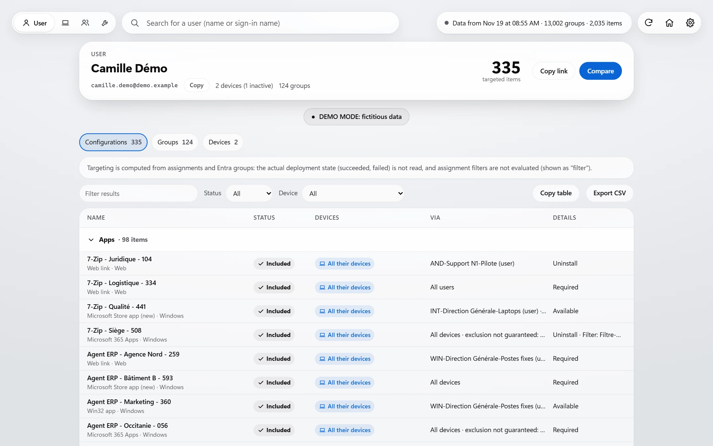
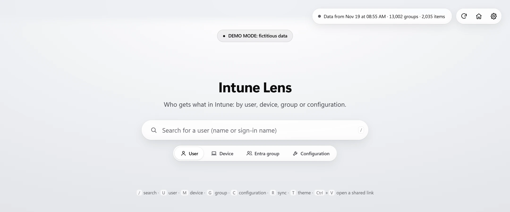
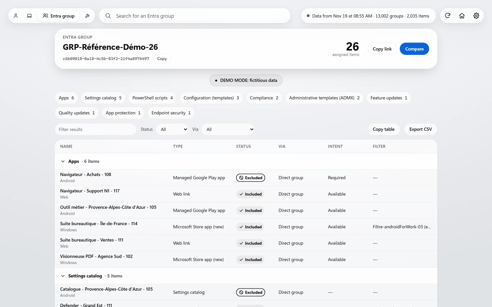
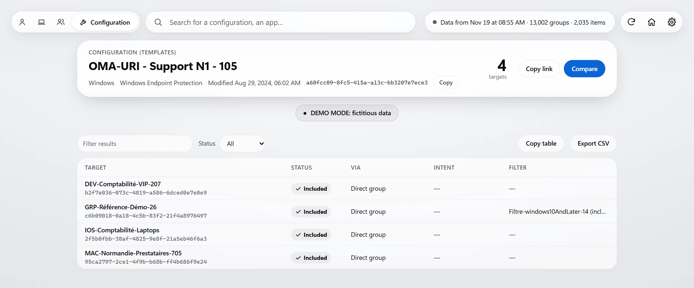
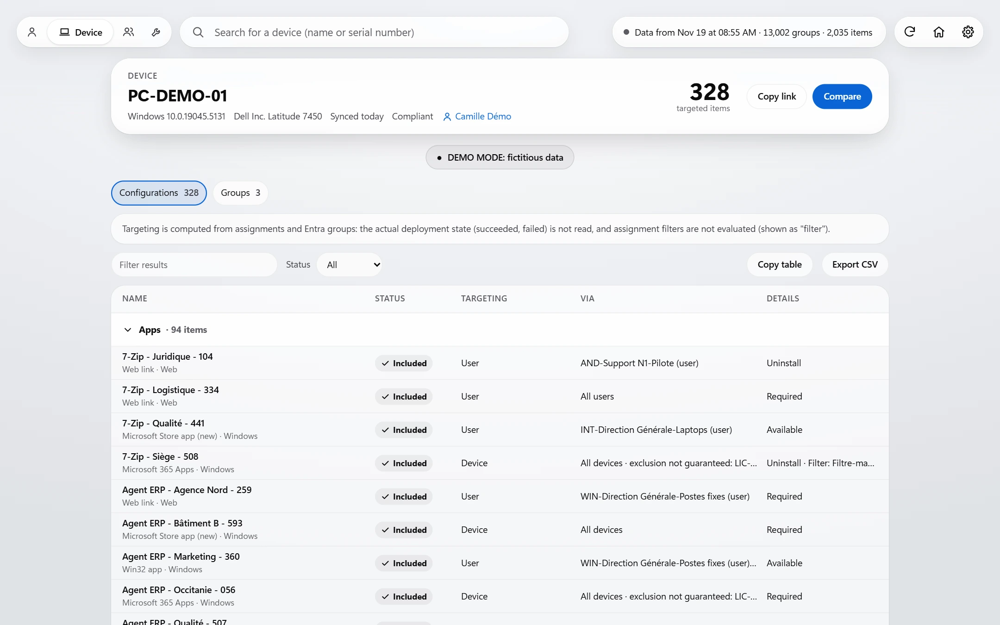
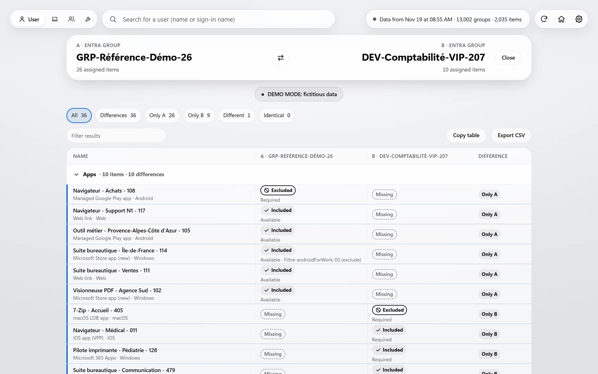
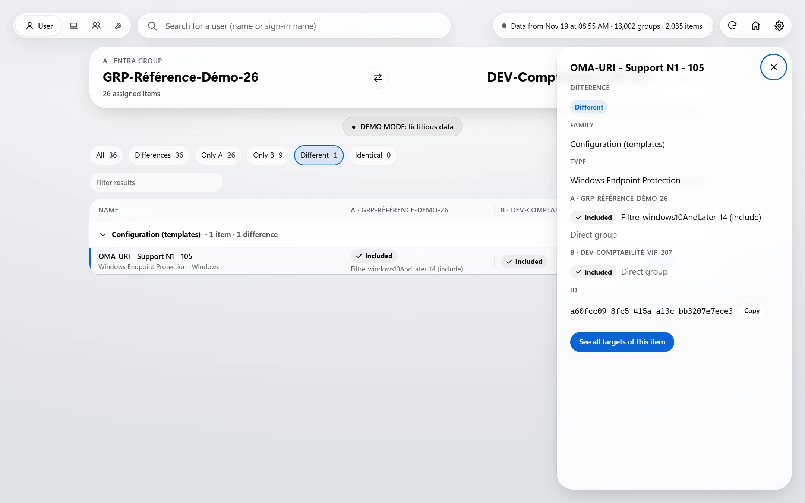
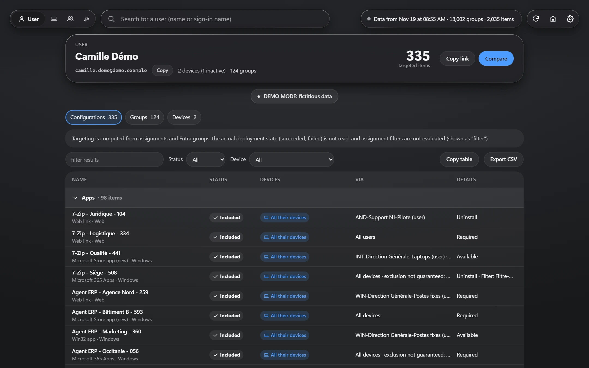

# Intune Lens

**Intune Lens** is a local, **read-only** tool that answers the questions the Intune portal makes you click around for:

- **User / Device**: which groups and which configurations target this person, PC by PC, or this device?
- **Group → items**: what is assigned to this Entra group (configurations, compliance policies, apps, scripts…)?
- **Item → groups**: which groups is this item assigned to, included or excluded?

The interface opens in Microsoft Edge. It is served by a small PowerShell server that listens on `127.0.0.1` only. No data leaves your computer apart from read requests to Microsoft Graph.

The interface is available in **English** (default) and **French**: ⚙ → Language. The choice is kept across restarts.

<p align="center">
  
</p>

---

## 1. Requirements

| Item | Details |
|---|---|
| System | Windows 10 or 11, up-to-date Microsoft Edge |
| PowerShell | **PowerShell 7** (`pwsh`). `Installer.cmd` offers to install it if missing. Windows PowerShell 5.1 is refused with a clear message. |
| Language mode | `FullLanguage`. In constrained mode (WDAC / AppLocker), the tool stops and explains why. |
| Graph module (real mode only) | `Microsoft.Graph.Authentication`. `Installer.cmd` offers to install it for your account. The tool itself never installs anything. |
| Local rights | **No administrator rights.** No service, no scheduled task, no registry changes. |
| Entra / Intune roles | Read access to Intune objects and groups, for example Global Reader or Intune Administrator. |
| Tenant | **Any tenant**: the tool connects to the tenant of the account you sign in with. Nothing is specific to one organization. |

## 2. Installation (once)

1. On the GitHub page: **Code** → **Download ZIP**.
   *Tip: right-click the ZIP → **Properties** → tick **Unblock** → OK. Windows will then show no warning.*
2. Right-click the ZIP → **Extract All…**, to a lasting folder, for example `Documents\Intune-Lens`.
3. In that folder, double-click **`Installer.cmd`**.
   - If Windows shows "Windows protected your PC": **More info** → **Run anyway**.
   - It finds PowerShell 7 (or offers to install it with `winget`), unblocks the folder's files, offers to install the `Microsoft.Graph.Authentication` module **for your account** (no administrator rights), then creates the **Intune Lens** shortcut with its logo on the **Desktop** and in the **Start menu**.
4. Double-click **Intune Lens**. Sign in with your work account: the tool opens in Edge, on your tenant.

What the setup does **not** do: no administrator rights, no registry, no scheduled task, no service. It never bypasses the execution policy (no `-ExecutionPolicy Bypass`): it only removes the "downloaded from the Internet" mark from the folder's files. On a computer where the policy is `AllSigned` or `Restricted`, it stops and says so.

- **Update**: download the new ZIP, replace the folder's content, run `Installer.cmd` again.
- **With Git**: `git clone https://github.com/Mino69-7/Intune-Lens.git`, then `Installer.cmd`.
- **Folder moved**: run `Installer.cmd` again, it recreates the shortcut.
- **Uninstall**: `pwsh -File .\setup\Install-IntuneLens.ps1 -Uninstall` (removes the shortcuts, offers to delete the cache and settings), then delete the folder.

## 3. Starting the tool

### Demo mode (fictitious data, no network)

```powershell
pwsh -File .\Start-IntuneAssignLens.ps1 -Mock
```

### Real mode (your tenant)

```powershell
pwsh -File .\Start-IntuneAssignLens.ps1
pwsh -File .\Start-IntuneAssignLens.ps1 -TenantId <tenant-id>   # to force a tenant
```

1. A Microsoft sign-in window opens. Sign in with your work account: the tool reads that account's tenant.
2. **First launch on a tenant**: Microsoft may show "Permissions requested" for **Microsoft Graph Command Line Tools**, the official application of the Microsoft Graph module.
   - Check that it only lists the **read** permissions from §5.
   - The Intune permissions require **admin consent**. If you are not an administrator, the screen offers to request approval; otherwise, ask an Entra administrator (Cloud Application Administrator or Global Administrator) to accept once for the organization.
   - If only `Device.Read.All` is refused, the tool still starts (see §5).
3. Edge opens on the interface. On the first launch, the full sync runs in the background; its progress is shown in the pill at the top right.
4. `Ctrl+C` in the console, or ⚙ → "Stop the tool", stops the server and closes the Graph session.

<p align="center">
  
</p>

### Starting with a double-click

`Installer.cmd` creates the **Intune Lens** shortcut (Desktop and Start menu). It runs `pwsh -NoProfile -File "<folder>\Start-IntuneAssignLens.ps1" -PauseOnError`: if startup fails, the window stays open with the message.
- The shortcut is not versioned (`.gitignore`): it contains paths specific to your computer.
- **Pin to Start**: Start → All apps → right-click "Intune Lens" → "Pin to Start". Or right-click the Desktop shortcut → "Pin to Start".
- **Pin to the taskbar**: right-click the shortcut → "Show more options" → "Pin to taskbar".
- The PowerShell window **must stay open** while you use the tool: closing it stops the tool.
- An Edge bookmark does not work: the port and the session token change at every launch.
- If you move the project folder, run `Installer.cmd` again.

### Parameters

| Parameter | Effect |
|---|---|
| `-Mock` | Fictitious data from `mock/fixtures`, no connection. |
| `-NoBrowser` | Does not open Edge; the address to open is shown in the console. |
| `-Port <n>` | Fixed local port (default: random free port). |
| `-TenantId <id>` | Forces the tenant at sign-in. |
| `-NoDiskCache` | Writes nothing to disk: no cache, log or settings. |
| `-PauseOnError` | On error, waits for Enter before closing the window (used by the shortcut). |
| `-EnableOptionalTypes <types>` | Also reads `deviceHealthScripts` (Remediations), `windowsAutopilotDeploymentProfiles` or `deviceEnrollmentConfigurations`. These types need a permission outside the requested scopes: they are read **only if your token already contains it**. The tool never requests it (see §5). |
| `-MockDataset modified` | Demo: "modified" dataset, to see the incremental sync. |
| `-DemoState syncing\|throttled\|error\|stale` | Demo: simulates a sync state in the interface. |

## 4. Using the tool

The illustrated guide (in French) is in [docs/guide-lecture.md](docs/guide-lecture.md).

| Key | Action |
|---|---|
| `/` | Search |
| `Esc` | Clear or close |
| `↑` `↓` | Move |
| `Enter` | Open |
| `U` / `M` / `G` / `C` | Search a User / Machine (device) / Group / Configuration |
| `R` / `Shift+R` | Incremental / full sync |
| `T` | Dark / light mode (also: ⚙ → "Dark mode" switch) |
| `Ctrl+V` | Open a link shared by a colleague |

- **Search** opens on **User**. The selector at the top switches between User, Device, Entra group and Configuration.
- **User page**: tabs **Configurations** (for each item, the PC or PCs concerned: "All their devices", one specific PC, or excluded on a PC), **Groups** (all their Entra groups, those used in Intune first, 20 per page) and **Devices** (last sync, compliance, "Inactive" after 30 days). The "Device" filter limits the list to one PC.
- **Device page**: primary user (clickable), the device's groups, targeted items with the "Targeting" column (through the user or through the device).
- **Targeted ≠ applied**: the pages show what the assignments target. The actual deployment state (succeeded, failed) is not read, and assignment filters are not evaluated (they are flagged).
- **Mixed exclusions**: when an item is included through a user group and excluded through a device group (or the other way round), Intune does not support the combination and the exclusion may not apply. The tool keeps the item "Included" and shows "exclusion not guaranteed".
- **Export**: "Export CSV" (`;` separator, UTF-8, opens directly in Excel) or "Copy table".
- **Compare**: on any page, click "Compare", then pick a second item of the same type in the search. Columns A and B are shown side by side, with filters "Differences", "Only A", "Only B", "Different" (included on one side, excluded on the other). ⇄ swaps A and B, "Close" goes back to A, `Esc` cancels the pick. Works for groups, configurations, users and devices.
- **Share a page**: the **Copy link** button at the top of each page copies an `intune-lens://user/<id>` link (type + Microsoft ID, nothing else). A colleague who has Intune Lens **pastes it (Ctrl+V)** anywhere in the tool and the page opens. The link is not clickable (Teams, email): that would require registering a protocol in the Windows registry, which the tool does not do. Your colleague only sees what their own Intune permissions allow them to read.
- **Global assignments** (All users / All devices): shown **for information** on a group page. This version does not compute the members' actual membership.

### Screenshots

*Demo mode, fictitious data.*

<table>
  <tr>
    <td width="50%"><br><sub><b>Entra group</b>: everything assigned to the group</sub></td>
    <td width="50%"><br><sub><b>Configuration</b>: every group the item is assigned to</sub></td>
  </tr>
  <tr>
    <td><br><sub><b>Device</b>: targeted through the user or the device</sub></td>
    <td><br><sub><b>Compare</b>: two groups side by side</sub></td>
  </tr>
  <tr>
    <td><br><sub><b>Detail</b>: why an item differs between A and B</sub></td>
    <td><br><sub><b>Dark mode</b> (<code>T</code>)</sub></td>
  </tr>
</table>

## 5. Microsoft Graph permissions

The tool requests **only** these 5 delegated **read** permissions:

| Permission | To read |
|---|---|
| `DeviceManagementConfiguration.Read.All` | Configurations, settings catalog, ADMX, compliance, PowerShell scripts, endpoint security, updates, filters |
| `DeviceManagementApps.Read.All` | Apps, app protection and app configuration |
| `DeviceManagementManagedDevices.Read.All` | Managed devices and their primary user (User / Device pages) |
| `Group.Read.All` | Group names, a user's groups |
| `Device.Read.All` | A device's groups (Entra device object) |

- **`Device.Read.All` is optional.** It requires admin consent, once. If it is refused, the tool signs in with the other 4 and works: only the devices' groups are missing, which the pages report ("Partial data").
- **Read-only by design.** Every request goes through a single function (`Invoke-GraphRead`) that refuses:
  - any method other than GET;
  - any host other than `graph.microsoft.com`.

  Only exception: the `$batch` request (POST), accepted only if **every** sub-request is a GET. The automated tests prove these refusals.
- **Optional types.** The Microsoft documentation requires another permission for **Remediations** (`DeviceManagementScripts.Read.All`), **Autopilot** and **Enrollment / ESP** (`DeviceManagementServiceConfig.Read.All`). These types are shown as "Not covered".
  - If your token already contains the permission (existing broad consent), the status pill menu says so.
  - You can then enable them with `-EnableOptionalTypes`.
- Details per endpoint, with links to the documentation, are in [docs/verifications.md](docs/verifications.md) (in French).

## 6. Data, cache, log and settings

- **Later launches**: the cached data is shown at once ("Data from …"). An **incremental** sync follows: only new or changed items are read again.
- **Full sync**: automatic if the last one is more than a day old, or on demand (`Shift+R`).
- **Cache**: `%LOCALAPPDATA%\IntuneAssignLens\cache\`.
  - The file is encrypted for your Windows account (DPAPI) and the folder is only accessible to your account.
  - Writes are atomic: a power cut does not corrupt the cache.
  - It contains names of configurations and groups, **never a token or script content**.
  - To clear it: status pill menu → "Clear the local cache".
- **Log**: `%LOCALAPPDATA%\IntuneAssignLens\logs\ial-YYYYMMDD.log`, plain text, no token.
- **Settings**: `%LOCALAPPDATA%\IntuneAssignLens\prefs.json` (language and theme only, no tenant data). The browser cannot keep them because the local port changes at every launch.
- **Incremental demo**: start with `-Mock`, stop, then start again with `-Mock -MockDataset modified`.

## 7. Security (summary)

- Listens on `127.0.0.1` only, random port.
- Access to the local server:
  - random 32-byte session token, compared in constant time;
  - checks on the `Host`, `Origin` and `Sec-Fetch-Site` headers;
  - file allow-list.
- Response headers:
  - **strict CSP** without any relaxation (`'self'` only);
  - `Permissions-Policy`, `nosniff`, `no-referrer`.
- No external resources: system fonts, no CDN, no telemetry. You can check in Edge: F12 → Network tab, only `127.0.0.1` appears.
- No elevation, no persistence, no hidden process. The only process started is Edge, in a visible window.
- Static check results: "Static" section of `tests/Run-Tests.ps1`.

## 8. Troubleshooting

| Symptom | Likely cause | What to do |
|---|---|---|
| "Intune Lens requires PowerShell 7" | Started with `powershell.exe` (5.1) | Use the shortcut, or `pwsh -File …` |
| "PowerShell is in ConstrainedLanguage mode" | WDAC / AppLocker | Check with your security team. The tool does not bypass anything. |
| "… is not digitally signed" / "cannot be loaded" | Files marked as downloaded | Run `Installer.cmd` again (it unblocks them), or `Get-ChildItem -Recurse -File \| Unblock-File` |
| `Installer.cmd`: "Execution policy AllSigned / Restricted" | Policy enforced by your organization | Check with your IT department: the tool does not bypass it |
| "Microsoft.Graph.Authentication module not found" | Module missing | Run `Installer.cmd` again, or `Install-Module Microsoft.Graph.Authentication -Scope CurrentUser` |
| "Need admin approval" at sign-in | The tenant has not consented to the read permissions yet (§5) | Ask an Entra administrator to accept them once for the organization |
| "Cannot listen on 127.0.0.1:…" | Port in use | Start again (random port) or use `-Port <other>` |
| Edge does not open | Edge not found | Start with `-NoBrowser` and open the address shown |
| "Invalid session" in the page | Page reloaded (`F5`) or tool restarted | Close the tab; the tool reopens Edge with a new link at every launch |
| "Server stopped" in the page | PowerShell console closed or `Ctrl+C` | Start the tool again |
| Orange pill "Microsoft is throttling requests" | Graph throttling (HTTP 429) | Nothing to do: it resumes automatically, respecting the delay requested by Microsoft |
| Console "Fallback: foreground sync" | The background sync cannot see the Graph session: automatic switch | Nothing to do. The interface does not respond during a sync. Please open an issue on GitHub. |
| Log "Assignments unreadable … (HTTP 4xx)" | Unexpected endpoint or permission | Open an issue on GitHub with the line (type and HTTP code) |
| Remediations / Autopilot / ESP missing | Permission outside the requested scopes | See §5 and the status pill menu ("can be enabled with …") |
| Log "Cache unreadable or corrupted: ignored" | Damaged file or from another version | Nothing to do: a full sync replaces it |

## 9. Tests

```powershell
pwsh -File .\tests\Run-Tests.ps1
```

A self-contained suite, in Mock mode, with no outgoing network. It covers:
- the read-only guard, data collection (paging, 429, 5xx), the Graph inventory;
- the index, search, incremental sync, the cache (simulated power cut);
- the local server, saved settings, and static checks (no forbidden commands, no external resources).

If Node.js is installed, the JavaScript syntax and the interface logic are also checked, in both languages. The manual test checklist for Edge is in [docs/test-manuel.md](docs/test-manuel.md) (in French).

## 10. Documentation

The detailed documents are in French.

| File | Content |
|---|---|
| [docs/guide-lecture.md](docs/guide-lecture.md) | How to read the interface |
| [docs/test-manuel.md](docs/test-manuel.md) | Manual test checklist in Edge |
| [docs/verifications.md](docs/verifications.md) | Verified points, Graph inventory with sources |
| [docs/decisions.md](docs/decisions.md) | Technical choices and their reasons |
| [docs/performance.md](docs/performance.md) | Measurements against the performance budgets |

## 11. Structure

```
Installer.cmd                one-double-click setup (shortcut, Graph module)
Start-IntuneAssignLens.ps1   entry point (started by the shortcut)
setup/    Install-IntuneLens.ps1: called by Installer.cmd; -Uninstall to uninstall
src/      Config, Log, GraphClient (only network access + guard), Collectors, Index, Cache, Sync, Server
web/      interface (plain HTML/CSS/JS, no build step); web/js/i18n.js = English / French texts
assets/   intune-lens.ico: Windows shortcut logo (16 to 256 px)
mock/     deterministic fictitious data generator + fixtures
tests/    Run-Tests.ps1 (PowerShell) + tests/web (Node, optional)
docs/     documentation (French)
```
